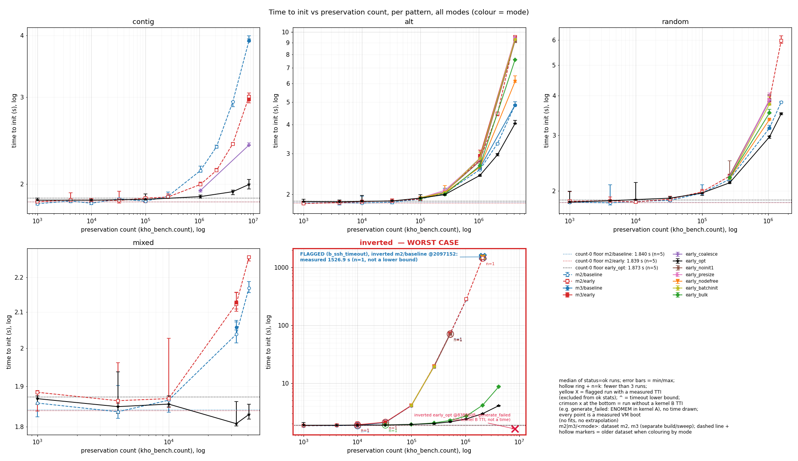
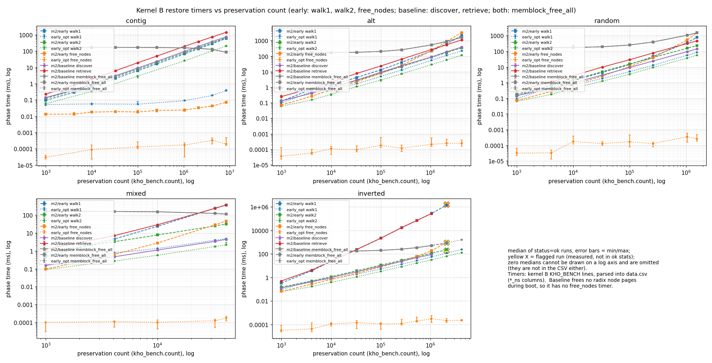
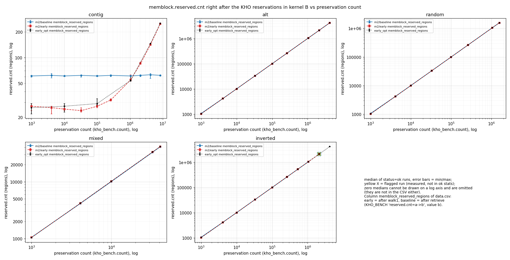

# KHO early memblock reservation: benchmark report

> Generated by `kho-bench/scripts/plot/kho_plot.py` from `kho-bench/results/m2/data.csv` (label m2, 400 rows, 400 used, sha256 `4cd198d4a3d137266941a0b58346a7c5ee76f57731963e16a856d4dd4936d735`); `kho-bench/results/m3/data.csv` (label m3, 452 rows, 452 used, sha256 `2d90b2d569ecd8c227b36cb2a669192e3e1ebfd06cb0719ccac01d3d8bf4bb6f`). Every number below is computed by that script from the raw per-boot rows; do not edit numbers by hand — regenerate with:
>
> `python3 kho-bench/scripts/plot/kho_plot.py --data kho-bench/results/m2/data.csv --data kho-bench/results/m3/data.csv --out kho-bench/graphs --report kho-bench/REPORT.md`

All measured numbers in this file come from the generated fragments. The prose
around them has no measured numbers. Two datasets are combined: **m2** (M2 sweep,
modes `baseline` and `early`) and **m3** (M3 sweep, the improvement modes plus
same-session `baseline`/`early` references). They are separate builds and separate
sweeps. A mode name that exists in both is shown as `m2/<mode>` and `m3/<mode>` and
is never merged; the improvement modes exist only in m3 and keep their plain names.
Comparisons in the tables are made within one dataset unless they are explicitly
labelled "across datasets".

## 1. Conclusion

- **Best mode: `early_opt`** (dataset m3). Rule (computed): lowest median TTI at the largest `inverted` count measured by at least two improvement modes (count 4194304: early_opt 4.082 s, early_bulk 8.701 s).
- **Highest median TTI of `early_opt` over all patterns and counts:** inverted 4194304 = **4.082 s** (n=3, range 4.023–4.103 s), +2.209 s over its count-0 floor of 1.873 s (n=5).
  - Next highest: alt 4194304 = 4.034 s (n=5, range 4.018–4.157 s). The min–max ranges **overlap**, so for `early_opt` the ranking of inverted above alt is within noise (read it as 'highest median', not a separated worst case).
- **Worst-case pattern overall: `inverted`** (highest measured TTI in any mode). Its measured TTI per mode:
  - m2/baseline: median 281.873 s at count 1048576 (n=3, range 281.144–282.111 s); 1526.863 s at count 2097152 (one run flagged `b_ssh_timeout`; a measured TTI, not a lower bound).
  - m2/early: median 284.940 s at count 1048576 (n=3, range 281.621–285.003 s); single ok run 1457.235 s at count 2097152 (n=1).
  - m3/baseline: median 19.204 s at count 262144 (n=3, range 19.080–19.386 s); single ok run 71.705 s at count 524288 (n=1).
  - m3/early: median 19.292 s at count 262144 (n=3, range 19.040–19.532 s); single ok run 71.100 s at count 524288 (n=1).
  - early_opt: median 4.082 s at count 4194304 (n=3, range 4.023–4.103 s); no TTI at count 8388608 (`generate_failed(rc=1);no_kernel_b;generate_failed`; kernel B not measured).
- Same dataset, inverted 524288: `early_opt` 2.135 s (n=5) vs `m3/baseline` 71.705 s (n=1): early_opt is ×33.6 faster (ranges separated).
- Same dataset, inverted 524288: `early_opt` 2.135 s (n=5) vs `m3/early` 71.100 s (n=1): early_opt is ×33.3 faster (ranges separated).
- Across datasets (different build and sweep; see Environment), inverted 1048576: `early_opt` 2.405 s (n=5) vs `m2/baseline` 281.873 s (n=3), ratio ×117.2.
- Across datasets (different build and sweep; see Environment), inverted 2097152: `early_opt` 2.969 s (n=5) vs `m2/early` 1457.235 s (n=1), ratio ×490.9.
- early_opt inverted 8388608 has no TTI: `generate_failed(rc=1);no_kernel_b;generate_failed` (kernel B never booted; not plotted as a time; log `kho-bench/results/m3/raw/early_opt_inverted_8388608_run1.log`).

**What this means:**
- The idea is **workable in this VM with small improvements**. The best mode's slowest
  measured point, over every pattern and count, is a few seconds above the
  no-preservation floor (bullets above).
- Without the improvements it is **not workable for the worst-case layout**. Plain
  `early` scales like `baseline` on `inverted`, because both insert one memblock
  region per preserved range into a sorted array. Measured times grow from seconds
  to many minutes over the swept counts.
- The decisive improvement for the worst case is building the reservations as
  sorted runs and merging them in bulk (`early_bulk`, included in `early_opt`). It
  removes the per-insert memmove that makes `inverted` quadratic (walk1 timer in
  section 7). On `alt` and `random`, which have no ordering problem, the largest
  single gain comes from not freeing the radix node pages against millions of
  regions (`early_nodefree`). `early_coalesce` helps only `contig`. The other single
  changes are small. Only the combination (`early_opt`) beats same-session
  `baseline` on every pattern. Section 7 has the per-mode numbers.
- The best mode's highest point and the next pattern's highest point may be within
  noise of each other (see the overlap statement above). In that case, read the
  per-pattern ranking for the best mode as "highest median", not as a separated
  worst case.

## 2. Summary

- **Worst case: `inverted`.** It has the highest measured time to init (TTI) of all tested patterns (ranking in [Worst case](#6-worst-case)). Its measured TTI:
  - m2/baseline: median 281.873 s at count 1048576 (n=3, range 281.144–282.111 s); 1526.863 s at count 2097152 (one run flagged `b_ssh_timeout`; a measured TTI, not a lower bound).
  - m2/early: median 284.940 s at count 1048576 (n=3, range 281.621–285.003 s); single ok run 1457.235 s at count 2097152 (n=1).
  - m3/baseline: median 19.204 s at count 262144 (n=3, range 19.080–19.386 s); single ok run 71.705 s at count 524288 (n=1).
  - m3/early: median 19.292 s at count 262144 (n=3, range 19.040–19.532 s); single ok run 71.100 s at count 524288 (n=1).
  - early_opt: median 4.082 s at count 4194304 (n=3, range 4.023–4.103 s); no TTI at count 8388608 (`generate_failed(rc=1);no_kernel_b;generate_failed`; kernel B not measured).
  - early_opt: `inverted` has the highest median TTI at 4 of 9 counts measured for 2+ patterns (counts 4096, 10000, 2097152, 4194304; highest ok median at the others: 1000 mixed, 32768 random, 100000 random, 262144 random, 1048576 random).
  - m2/baseline: `inverted` has the highest median TTI at 5 of 9 counts measured for 2+ patterns (counts 10000, 32768, 100000, 262144, 1048576; highest ok median at the others: 1000 mixed, 4096 contig, 2097152 alt, 4194304 alt).
  - m2/early: `inverted` has the highest median TTI at 6 of 9 counts measured for 2+ patterns (counts 4096, 10000, 100000, 262144, 1048576, 2097152; highest ok median at the others: 1000 mixed, 32768 mixed, 4194304 alt).
  - m3/baseline: `inverted` has the highest median TTI at 1 of 2 counts measured for 2+ patterns (counts 32768; highest ok median at the others: 1048576 random).
- Count-0 floor (no preservations), early_opt: median 1.873 s (n=5, range 1.847–1.890 s).
- Count-0 floor (no preservations), m2/baseline: median 1.840 s (n=5, range 1.821–1.974 s).
- Count-0 floor (no preservations), m2/early: median 1.839 s (n=5, range 1.828–1.857 s).
- Count-0 floor (no preservations), m3/baseline: median 1.848 s (n=3, range 1.828–1.884 s).
- Count-0 floor (no preservations), m3/early: median 1.854 s (n=3, range 1.843–1.886 s).
- early_opt vs baseline/early of the same dataset (same build and sweep), per pattern at the largest count measured in both (median TTI; ranges = min–max of ok runs):
  - contig 8388608: early_opt 1.997 s vs m3/baseline 3.909 s (-1.912 s, ref/mode ×1.96; n=5/5; ranges separated).
  - contig 8388608: early_opt 1.997 s vs m3/early 2.969 s (-0.972 s, ref/mode ×1.49; n=5/5; ranges separated).
  - alt 4194304: early_opt 4.034 s vs m3/baseline 4.850 s (-0.816 s, ref/mode ×1.20; n=5/5; ranges separated).
  - alt 4194304: early_opt 4.034 s vs m3/early 9.420 s (-5.386 s, ref/mode ×2.34; n=5/5; ranges separated).
  - random 1048576: early_opt 2.964 s vs m3/baseline 3.165 s (-0.201 s, ref/mode ×1.07; n=5/5; ranges separated).
  - random 1048576: early_opt 2.964 s vs m3/early 3.886 s (-0.922 s, ref/mode ×1.31; n=5/5; ranges separated).
  - mixed 32768: early_opt 1.807 s vs m3/baseline 2.057 s (-0.250 s, ref/mode ×1.14; n=5/5; ranges separated).
  - mixed 32768: early_opt 1.807 s vs m3/early 2.127 s (-0.320 s, ref/mode ×1.18; n=5/5; ranges separated).
  - inverted 524288: early_opt 2.135 s vs m3/baseline 71.705 s (-69.570 s, ref/mode ×33.58; n=5/1; ranges separated).
  - inverted 524288: early_opt 2.135 s vs m3/early 71.100 s (-68.965 s, ref/mode ×33.29; n=5/1; ranges separated).
- Data: 852 measured boots (rows) in 208 points; statuses `ok` (850 rows); `b_ssh_timeout` (1 row); `generate_failed(rc=1);no_kernel_b;generate_failed` (1 row); kernel B printed its init line in 851 of 852 boots; every row re-checked against its raw serial log (852 logs, 0 mismatches).

## 3. Method

- **Kernel A** is cold-booted in the VM with the user's `mk r`. It creates
  preservations with the built-in bench generator (`kho_bench.pattern=`,
  `kho_bench.count=`; patterns contig, alt, random, mixed, inverted). It then kexecs
  into **kernel B**, which is the same image.
- Kernel B selects the restore path at runtime with `kho_reserve_mode=`:
  - `baseline` is the upstream flow: bootmem-only mode, then
    `kho_preserved_memory_reserve()` per key in `kho_memory_init`.
  - `early` is the prototype:
    - right after memblock resizing is allowed, walk #1 runs `memblock_reserve()` on
      every preserved range and radix node page, and bootmem-only mode is turned off;
    - after memmap init, walk #2 initialises the struct pages;
    - the radix node pages are then freed.
  - The M3 improvement modes are `early` plus one change each (`early_noinit1`,
    `early_coalesce`, `early_presize`, `early_bulk`, `early_nodefree`,
    `early_batchinit`), and `early_opt` is all of them combined. Their definitions
    are in `kho-bench/results/m3/summary.md`.
- **Time to init (TTI)** is the printk timestamp of the last `Run /sbin/init as init
  process` in kernel B's part of the serial log. Timestamps restart at kexec.
- Each row of `data.csv` is one measured boot. A point (dataset, mode, pattern,
  count) is the median of its `status=ok` rows, with min/max as the error bars.
- Rows that are not plain `ok` are handled as follows:
  - A run that is flagged but still has an init line in its serial log is shown as a
    separate flagged value.
  - A timed-out run with no init line would be shown only as a lower bound.
  - A run where kernel A could not generate the layout (`generate_failed`, ENOMEM)
    has no kernel B boot. It is marked at its count without a time.
- Nothing is fitted, extrapolated or simulated. Every plotted value is a measured VM
  boot.
- Correctness (preserved data intact after kexec) was checked by separate verify
  boots that are not part of the timing data. See the "Correctness" sections of
  `kho-bench/results/m2/summary.md` and `kho-bench/results/m3/summary.md`.

- Rows used: 852; row classes: `ok` (850 rows); `flagged` (1 row); `failed` (1 row).
- Runs per point: 5 rows: 125 points, 3 rows: 72 points, 1 rows: 11 points.
- Kernel B timeout (`b_timeout_s` column): 1500 s.
- Measurement window (data.csv `timestamp`): 2026-11-11T03:42:10Z – 2026-11-11T14:04:25Z.

## 4. Environment

- Dataset m2 (`400` rows): build `#360 SMP PREEMPT_DYNAMIC Wed Nov 11 03:54:07 CET 2026` (400 rows); bzImage sha256 `93dfccc2ba49c52d8215a2da51da81cca6e0c40c89054d60a3c9216cd04ecae7` (400 rows); boots 2026-11-11T03:42:10Z – 2026-11-11T08:12:11Z; modes `m2/baseline`, `m2/early`.
- Dataset m3 (`452` rows): build `#365 SMP PREEMPT_DYNAMIC Wed Nov 11 10:35:40 CET 2026` (451 rows); `(empty)` (1 row); bzImage sha256 `5e3c8d47e5c6f4068a62123ff1848b60e47c104470e52331088c11c284f97a72` (452 rows); boots 2026-11-11T10:17:34Z – 2026-11-11T14:04:25Z; modes `early_batchinit`, `early_bulk`, `early_coalesce`, `early_nodefree`, `early_noinit1`, `early_opt`, `early_presize`, `m3/baseline`, `m3/early`.
- Kernel build (kernel B `Linux version` banner): `#365 SMP PREEMPT_DYNAMIC Wed Nov 11 10:35:40 CET 2026` (451 rows); `#360 SMP PREEMPT_DYNAMIC Wed Nov 11 03:54:07 CET 2026` (400 rows); `(empty)` (1 row).
- bzImage sha256: `5e3c8d47e5c6f4068a62123ff1848b60e47c104470e52331088c11c284f97a72` (452 rows); `93dfccc2ba49c52d8215a2da51da81cca6e0c40c89054d60a3c9216cd04ecae7` (400 rows).
- git describe: `v7.4-rc1-29-gfe0dae88a3989-dirty` (852 rows).
- Kernel B memory known to the kernel (`Memory: …K/<total>K`, kB): 67108332 (851 logs); None (1 logs).
- Kernel B CPUs (`smp: Brought up`): 8 CPUs, 1 node(s) (851 logs); None CPUs, None node(s) (1 logs).
- Kernel B 1G hugepages pre-allocated at boot: `0` (851 rows); `(empty)` (1 row).
- Kernel B cmdline mode: `nohp` (852 rows); common kernel B cmdline (per-run `kho_bench.*`, `kho_reserve_mode=` removed): `console=ttyS0 root=/dev/vda rw earlyprintk=serial net.ifnames=0 kho=1 liveupdate=1 nokaslr audit=0 tsc=reliable clocksource=tsc` (851 rows); `(empty)` (1 row).

## 5. Results (graphs)

**Headline: time to init vs preservation count, all patterns, modes `m2/baseline`, `m2/early`, `early_opt` (log-log)** — plotted points: [`tti_vs_count.csv`](graphs/tti_vs_count.csv)

**One panel per pattern, every mode (colour = mode)** — plotted points: [`tti_vs_count_by_pattern.csv`](graphs/tti_vs_count_by_pattern.csv)

**Worst-case pattern `inverted`: every mode vs count (left) and every mode of the best mode's dataset at one shared count (right)** — plotted points: [`tti_worst_case.csv`](graphs/tti_worst_case.csv)

**Scaling of the best mode `early_opt` across all patterns** — plotted points: [`tti_best_mode.csv`](graphs/tti_best_mode.csv)

**Companion: kernel B restore timers (ms) vs count, headline modes** — plotted points: [`restore_phases_vs_count.csv`](graphs/restore_phases_vs_count.csv)

**Companion: memblock.reserved.cnt after the KHO reservations vs count, headline modes** — plotted points: [`reserved_cnt_vs_count.csv`](graphs/reserved_cnt_vs_count.csv)

### Per-pattern tables (median TTI in s, [min–max] of ok runs, ok/rows)

#### contig

| count | m2/baseline median s [min–max] (ok/rows) | m2/early median s [min–max] (ok/rows) | m3/baseline median s [min–max] (ok/rows) | m3/early median s [min–max] (ok/rows) | early_noinit1 median s [min–max] (ok/rows) | early_coalesce median s [min–max] (ok/rows) | early_presize median s [min–max] (ok/rows) | early_nodefree median s [min–max] (ok/rows) | early_batchinit median s [min–max] (ok/rows) | early_bulk median s [min–max] (ok/rows) | early_opt median s [min–max] (ok/rows) |
|---:|---:|---:|---:|---:|---:|---:|---:|---:|---:|---:|---:|
| 1000 | 1.825 [1.814–1.842] (5/5) | 1.843 [1.827–1.859] (5/5) |  |  |  |  |  |  |  |  | 1.856 [1.847–1.872] (5/5) |
| 4096 | 1.848 [1.835–1.851] (5/5) | 1.857 [1.851–1.921] (5/5) |  |  |  |  |  |  |  |  |  |
| 10000 | 1.829 [1.817–1.851] (5/5) | 1.856 [1.834–1.864] (5/5) |  |  |  |  |  |  |  |  | 1.856 [1.838–1.863] (5/5) |
| 32768 | 1.866 [1.842–1.873] (5/5) | 1.853 [1.831–1.934] (5/5) |  |  |  |  |  |  |  |  |  |
| 100000 | 1.847 [1.842–1.866] (5/5) | 1.873 [1.835–1.882] (5/5) |  |  |  |  |  |  |  |  | 1.862 [1.859–1.911] (5/5) |
| 262144 | 1.889 [1.883–1.926] (5/5) | 1.883 [1.877–1.910] (5/5) |  |  |  |  |  |  |  |  |  |
| 1048576 | 2.129 [2.113–2.177] (5/5) | 1.996 [1.990–2.017] (5/5) |  |  |  | 1.940 [1.929–1.945] (3/3) |  |  |  |  | 1.887 [1.875–1.902] (5/5) |
| 2097152 | 2.381 [2.365–2.401] (5/5) | 2.132 [2.124–2.153] (5/5) |  |  |  |  |  |  |  |  |  |
| 4194304 | 2.936 [2.872–2.945] (5/5) | 2.413 [2.410–2.427] (5/5) |  |  |  |  |  |  |  |  | 1.930 [1.905–1.945] (5/5) |
| 8388608 | 3.906 [3.889–3.943] (5/5) | 3.007 [2.923–3.061] (5/5) | 3.909 [3.902–3.996] (5/5) | 2.969 [2.962–3.026] (5/5) |  | 2.400 [2.399–2.424] (3/3) |  |  |  |  | 1.997 [1.954–2.044] (5/5) |

#### alt

| count | m2/baseline median s [min–max] (ok/rows) | m2/early median s [min–max] (ok/rows) | m3/baseline median s [min–max] (ok/rows) | m3/early median s [min–max] (ok/rows) | early_noinit1 median s [min–max] (ok/rows) | early_coalesce median s [min–max] (ok/rows) | early_presize median s [min–max] (ok/rows) | early_nodefree median s [min–max] (ok/rows) | early_batchinit median s [min–max] (ok/rows) | early_bulk median s [min–max] (ok/rows) | early_opt median s [min–max] (ok/rows) |
|---:|---:|---:|---:|---:|---:|---:|---:|---:|---:|---:|---:|
| 1000 | 1.839 [1.818–1.849] (5/5) | 1.829 [1.827–1.869] (5/5) |  |  |  |  |  |  |  |  | 1.866 [1.857–1.905] (5/5) |
| 4096 | 1.844 [1.800–1.863] (5/5) | 1.845 [1.836–1.884] (5/5) |  |  |  |  |  |  |  |  | 1.858 [1.851–1.891] (5/5) |
| 10000 | 1.838 [1.824–1.964] (5/5) | 1.862 [1.826–1.883] (5/5) |  |  |  |  |  |  |  |  | 1.868 [1.838–1.982] (5/5) |
| 32768 | 1.852 [1.820–1.876] (5/5) | 1.876 [1.855–1.911] (5/5) |  |  |  |  |  |  |  |  | 1.875 [1.867–1.878] (5/5) |
| 100000 | 1.908 [1.906–1.924] (5/5) | 1.912 [1.903–1.927] (5/5) |  |  | 1.935 [1.906–1.939] (3/3) | 1.921 [1.920–1.924] (3/3) | 1.933 [1.909–1.946] (3/3) | 1.927 [1.917–1.939] (3/3) | 1.939 [1.925–1.941] (3/3) | 1.923 [1.900–1.924] (3/3) | 1.930 [1.879–1.995] (5/5) |
| 262144 | 2.026 [2.003–2.125] (5/5) | 2.044 [2.039–2.070] (5/5) |  |  | 2.050 [2.040–2.068] (3/3) | 2.051 [2.051–2.058] (3/3) | 2.081 [2.005–2.082] (3/3) | 2.034 [2.018–2.181] (3/3) | 2.039 [2.038–2.049] (3/3) | 2.005 [1.991–2.059] (3/3) | 1.997 [1.978–2.019] (5/5) |
| 1048576 | 2.556 [2.540–2.587] (5/5) | 2.817 [2.812–3.100] (5/5) | 2.600 [2.562–2.648] (5/5) | 2.931 [2.863–2.961] (5/5) | 2.782 [2.663–2.854] (3/3) | 2.868 [2.822–2.888] (3/3) | 2.833 [2.785–2.920] (3/3) | 2.622 [2.616–2.646] (3/3) | 2.862 [2.813–3.042] (3/3) | 2.656 [2.607–2.708] (3/3) | 2.415 [2.394–2.420] (5/5) |
| 2097152 | 3.312 [3.294–3.332] (5/5) | 4.451 [4.365–4.531] (5/5) |  |  |  |  |  |  |  |  | 2.962 [2.934–3.003] (5/5) |
| 4194304 | 4.846 [4.816–4.881] (5/5) | 9.499 [9.446–9.620] (5/5) | 4.850 [4.837–5.011] (5/5) | 9.420 [9.279–9.599] (5/5) | 9.144 [8.990–9.208] (3/3) | 9.390 [9.288–9.418] (3/3) | 9.414 [9.169–9.428] (3/3) | 6.117 [6.072–6.470] (3/3) | 9.286 [9.016–9.428] (3/3) | 7.597 [7.589–7.621] (3/3) | 4.034 [4.018–4.157] (5/5) |

#### random

| count | m2/baseline median s [min–max] (ok/rows) | m2/early median s [min–max] (ok/rows) | m3/baseline median s [min–max] (ok/rows) | m3/early median s [min–max] (ok/rows) | early_noinit1 median s [min–max] (ok/rows) | early_coalesce median s [min–max] (ok/rows) | early_presize median s [min–max] (ok/rows) | early_nodefree median s [min–max] (ok/rows) | early_batchinit median s [min–max] (ok/rows) | early_bulk median s [min–max] (ok/rows) | early_opt median s [min–max] (ok/rows) |
|---:|---:|---:|---:|---:|---:|---:|---:|---:|---:|---:|---:|
| 1000 | 1.844 [1.827–1.849] (5/5) | 1.856 [1.841–1.992] (5/5) |  |  |  |  |  |  |  |  | 1.845 [1.833–1.998] (5/5) |
| 4096 | 1.835 [1.806–2.092] (5/5) | 1.863 [1.849–1.915] (5/5) |  |  |  |  |  |  |  |  | 1.863 [1.855–1.881] (5/5) |
| 10000 | 1.854 [1.837–1.870] (5/5) | 1.847 [1.833–1.884] (5/5) |  |  |  |  |  |  |  |  | 1.879 [1.858–2.125] (5/5) |
| 32768 | 1.869 [1.852–1.884] (5/5) | 1.885 [1.864–1.924] (5/5) |  |  |  |  |  |  |  |  | 1.898 [1.869–1.922] (5/5) |
| 100000 | 1.969 [1.958–2.094] (5/5) | 1.987 [1.968–2.024] (5/5) |  |  |  |  |  |  |  |  | 1.971 [1.935–1.995] (5/5) |
| 262144 | 2.179 [2.165–2.258] (5/5) | 2.229 [2.210–2.259] (5/5) |  |  | 2.242 [2.234–2.492] (3/3) | 2.217 [2.199–2.242] (3/3) | 2.218 [2.213–2.232] (3/3) | 2.193 [2.180–2.218] (3/3) | 2.196 [2.174–2.207] (3/3) | 2.207 [2.202–2.228] (3/3) | 2.123 [2.114–2.147] (5/5) |
| 1048576 | 3.161 [3.139–3.180] (5/5) | 3.873 [3.767–4.008] (5/5) | 3.165 [3.156–3.226] (5/5) | 3.886 [3.814–4.015] (5/5) | 3.877 [3.735–4.039] (3/3) | 3.856 [3.773–4.015] (3/3) | 3.892 [3.851–4.081] (3/3) | 3.365 [3.340–3.375] (3/3) | 3.767 [3.729–3.964] (3/3) | 3.530 [3.509–3.625] (3/3) | 2.964 [2.931–2.982] (5/5) |
| 1572864 | 3.816 [3.798–3.839] (5/5) | 5.957 [5.856–6.183] (5/5) |  |  |  |  |  |  |  |  | 3.505 [3.486–3.530] (3/3) |

#### mixed

| count | m2/baseline median s [min–max] (ok/rows) | m2/early median s [min–max] (ok/rows) | m3/baseline median s [min–max] (ok/rows) | m3/early median s [min–max] (ok/rows) | early_noinit1 median s [min–max] (ok/rows) | early_coalesce median s [min–max] (ok/rows) | early_presize median s [min–max] (ok/rows) | early_nodefree median s [min–max] (ok/rows) | early_batchinit median s [min–max] (ok/rows) | early_bulk median s [min–max] (ok/rows) | early_opt median s [min–max] (ok/rows) |
|---:|---:|---:|---:|---:|---:|---:|---:|---:|---:|---:|---:|
| 1000 | 1.858 [1.824–1.882] (5/5) | 1.885 [1.838–1.890] (5/5) |  |  |  |  |  |  |  |  | 1.869 [1.855–1.876] (5/5) |
| 4096 | 1.836 [1.820–1.902] (5/5) | 1.864 [1.857–1.961] (5/5) |  |  |  |  |  |  |  |  | 1.849 [1.832–1.937] (5/5) |
| 10000 | 1.865 [1.835–1.869] (5/5) | 1.869 [1.848–2.027] (5/5) |  |  |  |  |  |  |  |  | 1.855 [1.848–1.876] (5/5) |
| 32768 | 2.038 [2.015–2.072] (5/5) | 2.123 [2.102–2.156] (5/5) | 2.057 [2.050–2.076] (5/5) | 2.127 [2.108–2.156] (5/5) |  |  |  |  |  |  | 1.807 [1.801–1.862] (5/5) |
| 40960 | 2.169 [2.156–2.188] (3/3) | 2.260 [2.250–2.261] (3/3) |  |  |  |  |  |  |  |  | 1.830 [1.818–1.855] (5/5) |

#### inverted

| count | m2/baseline median s [min–max] (ok/rows) | m2/early median s [min–max] (ok/rows) | m3/baseline median s [min–max] (ok/rows) | m3/early median s [min–max] (ok/rows) | early_noinit1 median s [min–max] (ok/rows) | early_coalesce median s [min–max] (ok/rows) | early_presize median s [min–max] (ok/rows) | early_nodefree median s [min–max] (ok/rows) | early_batchinit median s [min–max] (ok/rows) | early_bulk median s [min–max] (ok/rows) | early_opt median s [min–max] (ok/rows) |
|---:|---:|---:|---:|---:|---:|---:|---:|---:|---:|---:|---:|
| 1000 | 1.832 [1.805–1.854] (5/5) | 1.839 [1.821–1.855] (5/5) |  |  |  |  |  |  |  |  | 1.866 [1.845–2.085] (5/5) |
| 4096 | 1.839 [1.835–1.860] (5/5) | 1.868 [1.824–1.925] (5/5) |  |  |  |  |  |  |  |  | 1.869 [1.829–1.878] (5/5) |
| 10000 | 1.873 [1.841–1.883] (5/5) | 1.873 [1.850–2.159] (5/5) | 1.857 [1.857–1.857] (1/1) | 1.907 [1.907–1.907] (1/1) |  |  |  |  |  |  | 1.885 [1.857–1.895] (5/5) |
| 32768 | 2.096 [2.068–2.118] (5/5) | 2.086 [2.079–2.142] (5/5) | 2.082 [2.082–2.082] (1/1) | 2.108 [2.108–2.108] (1/1) |  |  |  |  |  | 1.891 [1.891–1.891] (1/1) | 1.886 [1.878–1.904] (5/5) |
| 100000 | 4.087 [4.065–4.098] (5/5) | 4.102 [4.091–4.141] (5/5) | 4.106 [4.067–4.129] (5/5) | 4.111 [4.085–4.164] (5/5) | 4.107 [4.075–4.121] (3/3) | 4.097 [4.089–4.111] (3/3) | 4.126 [4.110–4.147] (3/3) | 4.152 [4.080–4.172] (3/3) | 4.116 [4.102–4.133] (3/3) | 1.925 [1.893–1.932] (3/3) | 1.930 [1.895–1.961] (5/5) |
| 262144 | 19.471 [19.115–19.585] (5/5) | 19.716 [19.080–20.173] (5/5) | 19.204 [19.080–19.386] (3/3) | 19.292 [19.040–19.532] (3/3) | 19.200 [19.156–19.248] (3/3) | 19.247 [19.118–19.518] (3/3) | 19.287 [18.877–19.478] (3/3) | 19.393 [19.072–19.429] (3/3) | 19.321 [19.022–19.458] (3/3) | 2.051 [2.001–2.080] (3/3) | 2.005 [1.972–2.042] (5/5) |
| 524288 | 71.214 [70.658–71.400] (3/3) | 72.077 [71.250–72.381] (3/3) | 71.705 [71.705–71.705] (1/1) | 71.100 [71.100–71.100] (1/1) | 70.074 [70.074–70.074] (1/1) |  |  |  |  | 2.262 [2.211–2.349] (3/3) | 2.135 [2.125–2.145] (5/5) |
| 1048576 | 281.873 [281.144–282.111] (3/3) | 284.940 [281.621–285.003] (3/3) |  |  |  |  |  |  |  | 2.703 [2.674–2.706] (3/3) | 2.405 [2.385–2.415] (5/5) |
| 2097152 |  **flagged b_ssh_timeout: 1526.863 s** | 1457.235 [1457.235–1457.235] (1/1) |  |  |  |  |  |  |  | 4.153 [4.140–4.221] (3/3) | 2.969 [2.932–2.972] (5/5) |
| 4194304 |  |  |  |  |  |  |  |  |  | 8.701 [8.692–9.008] (3/3) | 4.082 [4.023–4.103] (3/3) |
| 8388608 |  |  |  |  |  |  |  |  |  |  |  failed: generate_failed(rc=1);no_kernel_b;generate_failed |

## 6. Worst case

Selection rule (computed): the pattern with the highest measured TTI (ok median or flagged measured value) over all modes and counts. Ranking:

| pattern | highest measured TTI s | kind | mode | count | ok runs |
|---|---:|---|---|---:|---:|
| inverted | 1526.863 | flagged | m2/baseline | 2097152 | 0 |
| alt | 9.499 | median | m2/early | 4194304 | 5 |
| random | 5.957 | median | m2/early | 1572864 | 5 |
| contig | 3.909 | median | m3/baseline | 8388608 | 5 |
| mixed | 2.260 | median | m2/early | 40960 | 3 |

Growth of the worst-case pattern's median TTI between consecutive measured counts (ratios of measured medians; no fit):

- m2/baseline: 1000→4096 (count ×4.10): TTI ×1.00; 4096→10000 (count ×2.44): TTI ×1.02; 10000→32768 (count ×3.28): TTI ×1.12; 32768→100000 (count ×3.05): TTI ×1.95; 100000→262144 (count ×2.62): TTI ×4.76; 262144→524288 (count ×2.00): TTI ×3.66; 524288→1048576 (count ×2.00): TTI ×3.96.
- m2/early: 1000→4096 (count ×4.10): TTI ×1.02; 4096→10000 (count ×2.44): TTI ×1.00; 10000→32768 (count ×3.28): TTI ×1.11; 32768→100000 (count ×3.05): TTI ×1.97; 100000→262144 (count ×2.62): TTI ×4.81; 262144→524288 (count ×2.00): TTI ×3.66; 524288→1048576 (count ×2.00): TTI ×3.95; 1048576→2097152 (count ×2.00): TTI ×5.11.
- m3/baseline: 10000→32768 (count ×3.28): TTI ×1.12; 32768→100000 (count ×3.05): TTI ×1.97; 100000→262144 (count ×2.62): TTI ×4.68; 262144→524288 (count ×2.00): TTI ×3.73.
- m3/early: 10000→32768 (count ×3.28): TTI ×1.11; 32768→100000 (count ×3.05): TTI ×1.95; 100000→262144 (count ×2.62): TTI ×4.69; 262144→524288 (count ×2.00): TTI ×3.69.
- early_noinit1: 100000→262144 (count ×2.62): TTI ×4.67; 262144→524288 (count ×2.00): TTI ×3.65.
- early_coalesce: 100000→262144 (count ×2.62): TTI ×4.70.
- early_presize: 100000→262144 (count ×2.62): TTI ×4.67.
- early_nodefree: 100000→262144 (count ×2.62): TTI ×4.67.
- early_batchinit: 100000→262144 (count ×2.62): TTI ×4.69.
- early_bulk: 32768→100000 (count ×3.05): TTI ×1.02; 100000→262144 (count ×2.62): TTI ×1.07; 262144→524288 (count ×2.00): TTI ×1.10; 524288→1048576 (count ×2.00): TTI ×1.19; 1048576→2097152 (count ×2.00): TTI ×1.54; 2097152→4194304 (count ×2.00): TTI ×2.09.
- early_opt: 1000→4096 (count ×4.10): TTI ×1.00; 4096→10000 (count ×2.44): TTI ×1.01; 10000→32768 (count ×3.28): TTI ×1.00; 32768→100000 (count ×3.05): TTI ×1.02; 100000→262144 (count ×2.62): TTI ×1.04; 262144→524288 (count ×2.00): TTI ×1.07; 524288→1048576 (count ×2.00): TTI ×1.13; 1048576→2097152 (count ×2.00): TTI ×1.23; 2097152→4194304 (count ×2.00): TTI ×1.38.

Measured TTI of the worst-case pattern `inverted` at its three largest counts per mode:

| mode | count | ok/rows | median s | min s | max s | flagged (measured) | timeout lower bound | raw logs |
|---|---:|---:|---:|---:|---:|---|---|---|
| m2/baseline | 524288 | 3/3 | 71.214 | 70.658 | 71.400 |  |  | `kho-bench/results/m2/raw/baseline_inverted_524288_run1.log` `kho-bench/results/m2/raw/baseline_inverted_524288_run2.log` `kho-bench/results/m2/raw/baseline_inverted_524288_run3.log` |
| m2/baseline | 1048576 | 3/3 | 281.873 | 281.144 | 282.111 |  |  | `kho-bench/results/m2/raw/baseline_inverted_1048576_run1.log` `kho-bench/results/m2/raw/baseline_inverted_1048576_run2.log` `kho-bench/results/m2/raw/baseline_inverted_1048576_run3.log` |
| m2/baseline | 2097152 | 0/1 | - | - | - | 1526.863 s (b_ssh_timeout) |  | `kho-bench/results/m2/raw/baseline_inverted_2097152_run1.log` |
| m2/early | 524288 | 3/3 | 72.077 | 71.250 | 72.381 |  |  | `kho-bench/results/m2/raw/early_inverted_524288_run1.log` `kho-bench/results/m2/raw/early_inverted_524288_run2.log` `kho-bench/results/m2/raw/early_inverted_524288_run3.log` |
| m2/early | 1048576 | 3/3 | 284.940 | 281.621 | 285.003 |  |  | `kho-bench/results/m2/raw/early_inverted_1048576_run1.log` `kho-bench/results/m2/raw/early_inverted_1048576_run2.log` `kho-bench/results/m2/raw/early_inverted_1048576_run3.log` |
| m2/early | 2097152 | 1/1 | 1457.235 | 1457.235 | 1457.235 |  |  | `kho-bench/results/m2/raw/early_inverted_2097152_run1.log` |
| m3/baseline | 100000 | 5/5 | 4.106 | 4.067 | 4.129 |  |  | `kho-bench/results/m3/raw/baseline_inverted_100000_run1.log` `kho-bench/results/m3/raw/baseline_inverted_100000_run2.log` `kho-bench/results/m3/raw/baseline_inverted_100000_run3.log` `kho-bench/results/m3/raw/baseline_inverted_100000_run4.log` `kho-bench/results/m3/raw/baseline_inverted_100000_run5.log` |
| m3/baseline | 262144 | 3/3 | 19.204 | 19.080 | 19.386 |  |  | `kho-bench/results/m3/raw/baseline_inverted_262144_run1.log` `kho-bench/results/m3/raw/baseline_inverted_262144_run2.log` `kho-bench/results/m3/raw/baseline_inverted_262144_run3.log` |
| m3/baseline | 524288 | 1/1 | 71.705 | 71.705 | 71.705 |  |  | `kho-bench/results/m3/raw/baseline_inverted_524288_run1.log` |
| m3/early | 100000 | 5/5 | 4.111 | 4.085 | 4.164 |  |  | `kho-bench/results/m3/raw/early_inverted_100000_run1.log` `kho-bench/results/m3/raw/early_inverted_100000_run2.log` `kho-bench/results/m3/raw/early_inverted_100000_run3.log` `kho-bench/results/m3/raw/early_inverted_100000_run4.log` `kho-bench/results/m3/raw/early_inverted_100000_run5.log` |
| m3/early | 262144 | 3/3 | 19.292 | 19.040 | 19.532 |  |  | `kho-bench/results/m3/raw/early_inverted_262144_run1.log` `kho-bench/results/m3/raw/early_inverted_262144_run2.log` `kho-bench/results/m3/raw/early_inverted_262144_run3.log` |
| m3/early | 524288 | 1/1 | 71.100 | 71.100 | 71.100 |  |  | `kho-bench/results/m3/raw/early_inverted_524288_run1.log` |
| early_noinit1 | 100000 | 3/3 | 4.107 | 4.075 | 4.121 |  |  | `kho-bench/results/m3/raw/early_noinit1_inverted_100000_run1.log` `kho-bench/results/m3/raw/early_noinit1_inverted_100000_run2.log` `kho-bench/results/m3/raw/early_noinit1_inverted_100000_run3.log` |
| early_noinit1 | 262144 | 3/3 | 19.200 | 19.156 | 19.248 |  |  | `kho-bench/results/m3/raw/early_noinit1_inverted_262144_run1.log` `kho-bench/results/m3/raw/early_noinit1_inverted_262144_run2.log` `kho-bench/results/m3/raw/early_noinit1_inverted_262144_run3.log` |
| early_noinit1 | 524288 | 1/1 | 70.074 | 70.074 | 70.074 |  |  | `kho-bench/results/m3/raw/early_noinit1_inverted_524288_run1.log` |
| early_coalesce | 100000 | 3/3 | 4.097 | 4.089 | 4.111 |  |  | `kho-bench/results/m3/raw/early_coalesce_inverted_100000_run1.log` `kho-bench/results/m3/raw/early_coalesce_inverted_100000_run2.log` `kho-bench/results/m3/raw/early_coalesce_inverted_100000_run3.log` |
| early_coalesce | 262144 | 3/3 | 19.247 | 19.118 | 19.518 |  |  | `kho-bench/results/m3/raw/early_coalesce_inverted_262144_run1.log` `kho-bench/results/m3/raw/early_coalesce_inverted_262144_run2.log` `kho-bench/results/m3/raw/early_coalesce_inverted_262144_run3.log` |
| early_presize | 100000 | 3/3 | 4.126 | 4.110 | 4.147 |  |  | `kho-bench/results/m3/raw/early_presize_inverted_100000_run1.log` `kho-bench/results/m3/raw/early_presize_inverted_100000_run2.log` `kho-bench/results/m3/raw/early_presize_inverted_100000_run3.log` |
| early_presize | 262144 | 3/3 | 19.287 | 18.877 | 19.478 |  |  | `kho-bench/results/m3/raw/early_presize_inverted_262144_run1.log` `kho-bench/results/m3/raw/early_presize_inverted_262144_run2.log` `kho-bench/results/m3/raw/early_presize_inverted_262144_run3.log` |
| early_nodefree | 100000 | 3/3 | 4.152 | 4.080 | 4.172 |  |  | `kho-bench/results/m3/raw/early_nodefree_inverted_100000_run1.log` `kho-bench/results/m3/raw/early_nodefree_inverted_100000_run2.log` `kho-bench/results/m3/raw/early_nodefree_inverted_100000_run3.log` |
| early_nodefree | 262144 | 3/3 | 19.393 | 19.072 | 19.429 |  |  | `kho-bench/results/m3/raw/early_nodefree_inverted_262144_run1.log` `kho-bench/results/m3/raw/early_nodefree_inverted_262144_run2.log` `kho-bench/results/m3/raw/early_nodefree_inverted_262144_run3.log` |
| early_batchinit | 100000 | 3/3 | 4.116 | 4.102 | 4.133 |  |  | `kho-bench/results/m3/raw/early_batchinit_inverted_100000_run1.log` `kho-bench/results/m3/raw/early_batchinit_inverted_100000_run2.log` `kho-bench/results/m3/raw/early_batchinit_inverted_100000_run3.log` |
| early_batchinit | 262144 | 3/3 | 19.321 | 19.022 | 19.458 |  |  | `kho-bench/results/m3/raw/early_batchinit_inverted_262144_run1.log` `kho-bench/results/m3/raw/early_batchinit_inverted_262144_run2.log` `kho-bench/results/m3/raw/early_batchinit_inverted_262144_run3.log` |
| early_bulk | 1048576 | 3/3 | 2.703 | 2.674 | 2.706 |  |  | `kho-bench/results/m3/raw/early_bulk_inverted_1048576_run1.log` `kho-bench/results/m3/raw/early_bulk_inverted_1048576_run2.log` `kho-bench/results/m3/raw/early_bulk_inverted_1048576_run3.log` |
| early_bulk | 2097152 | 3/3 | 4.153 | 4.140 | 4.221 |  |  | `kho-bench/results/m3/raw/early_bulk_inverted_2097152_run1.log` `kho-bench/results/m3/raw/early_bulk_inverted_2097152_run2.log` `kho-bench/results/m3/raw/early_bulk_inverted_2097152_run3.log` |
| early_bulk | 4194304 | 3/3 | 8.701 | 8.692 | 9.008 |  |  | `kho-bench/results/m3/raw/early_bulk_inverted_4194304_run1.log` `kho-bench/results/m3/raw/early_bulk_inverted_4194304_run2.log` `kho-bench/results/m3/raw/early_bulk_inverted_4194304_run3.log` |
| early_opt | 2097152 | 5/5 | 2.969 | 2.932 | 2.972 |  |  | `kho-bench/results/m3/raw/early_opt_inverted_2097152_run1.log` `kho-bench/results/m3/raw/early_opt_inverted_2097152_run2.log` `kho-bench/results/m3/raw/early_opt_inverted_2097152_run3.log` `kho-bench/results/m3/raw/early_opt_inverted_2097152_run4.log` `kho-bench/results/m3/raw/early_opt_inverted_2097152_run5.log` |
| early_opt | 4194304 | 3/3 | 4.082 | 4.023 | 4.103 |  |  | `kho-bench/results/m3/raw/early_opt_inverted_4194304_run1.log` `kho-bench/results/m3/raw/early_opt_inverted_4194304_run2.log` `kho-bench/results/m3/raw/early_opt_inverted_4194304_run3.log` |
| early_opt | 8388608 | 0/1 | - | - | - |  |  |  |

Mechanism (from M2 analysis, `kho-bench/results/m2/summary.md`, "Why"):
- The radix walk visits higher orders first, so the high-address blocks are reserved
  first.
- Each later lower-address reserve lands in front of them, and
  `memblock_insert_region()` memmoves most of the reserved array.
- The reserve phase is nearly all of kernel B's TTI at large counts (see the
  restore-phase graph). `early_bulk`/`early_opt` replace these inserts with sorted
  bulk merges.

## 7. Improvement effects per mode

Improvement modes in the inputs: `early_noinit1`, `early_coalesce`, `early_presize`, `early_nodefree`, `early_batchinit`, `early_bulk`, `early_opt`. Each is compared with `early` (and `baseline`) **of the same dataset** at the largest count of each pattern measured in both. `early / mode` > 1 means the mode is faster. Phase timers are medians of the ok runs (ms; mode vs early).

| mode | pattern | count | mode median s [min–max] (n) | early median s (n) | early / mode | baseline median s (n) | baseline / mode | ranges vs early | walk1 ms | free_nodes ms | walk2 ms | memblock_free_all ms |
|---|---|---:|---|---|---:|---|---:|---|---|---|---|---|
| early_noinit1 | alt | 4194304 | 9.144 [8.990–9.208] (3) | 9.420 (5) | ×1.03 | 4.850 (5) | ×0.53 | separated | 1795.3 vs 2055.5 | 3268.5 vs 3355.2 | 349.7 vs 349.0 | 1623.2 vs 1624.3 |
| early_noinit1 | random | 1048576 | 3.877 [3.735–4.039] (3) | 3.886 (5) | ×1.00 | 3.165 (5) | ×0.82 | overlap | 304.7 vs 354.1 | 556.1 vs 521.4 | 161.4 vs 160.4 | 1071.6 vs 1072.5 |
| early_noinit1 | inverted | 524288 | 70.074 [70.074–70.074] (1) | 71.100 (1) | ×1.01 | 71.705 (1) | ×1.02 | separated | 67890.3 vs 68867.4 | 62.4 vs 60.2 | 58.3 vs 58.4 | 347.3 vs 350.2 |
| early_coalesce | contig | 8388608 | 2.400 [2.399–2.424] (3) | 2.969 (5) | ×1.24 | 3.909 (5) | ×1.63 | separated | 0.2 vs 555.8 | 0.1 vs 0.1 | 655.1 vs 659.1 | 84.6 vs 84.6 |
| early_coalesce | alt | 4194304 | 9.390 [9.288–9.418] (3) | 9.420 (5) | ×1.00 | 4.850 (5) | ×0.52 | overlap | 1987.6 vs 2055.5 | 3299.7 vs 3355.2 | 341.2 vs 349.0 | 1623.0 vs 1624.3 |
| early_coalesce | random | 1048576 | 3.856 [3.773–4.015] (3) | 3.886 (5) | ×1.01 | 3.165 (5) | ×0.82 | overlap | 334.0 vs 354.1 | 534.7 vs 521.4 | 160.0 vs 160.4 | 1070.3 vs 1072.5 |
| early_coalesce | inverted | 262144 | 19.247 [19.118–19.518] (3) | 19.292 (3) | ×1.00 | 19.204 (3) | ×1.00 | overlap | 17235.3 vs 17260.6 | 25.1 vs 25.6 | 29.6 vs 29.7 | 255.9 vs 259.7 |
| early_presize | alt | 4194304 | 9.414 [9.169–9.428] (3) | 9.420 (5) | ×1.00 | 4.850 (5) | ×0.52 | overlap | 1900.0 vs 2055.5 | 3430.9 vs 3355.2 | 348.1 vs 349.0 | 1626.7 vs 1624.3 |
| early_presize | random | 1048576 | 3.892 [3.851–4.081] (3) | 3.886 (5) | ×1.00 | 3.165 (5) | ×0.81 | overlap | 316.0 vs 354.1 | 580.6 vs 521.4 | 160.8 vs 160.4 | 1071.6 vs 1072.5 |
| early_presize | inverted | 262144 | 19.287 [18.877–19.478] (3) | 19.292 (3) | ×1.00 | 19.204 (3) | ×1.00 | overlap | 17266.4 vs 17260.6 | 23.3 vs 25.6 | 29.3 vs 29.7 | 254.8 vs 259.7 |
| early_nodefree | alt | 4194304 | 6.117 [6.072–6.470] (3) | 9.420 (5) | ×1.54 | 4.850 (5) | ×0.79 | separated | 2063.1 vs 2055.5 | 0.0 vs 3355.2 | 348.0 vs 349.0 | 1621.9 vs 1624.3 |
| early_nodefree | random | 1048576 | 3.365 [3.340–3.375] (3) | 3.886 (5) | ×1.15 | 3.165 (5) | ×0.94 | separated | 347.9 vs 354.1 | 0.0 vs 521.4 | 160.4 vs 160.4 | 1073.8 vs 1072.5 |
| early_nodefree | inverted | 262144 | 19.393 [19.072–19.429] (3) | 19.292 (3) | ×0.99 | 19.204 (3) | ×0.99 | overlap | 17410.4 vs 17260.6 | 0.0 vs 25.6 | 29.0 vs 29.7 | 253.3 vs 259.7 |
| early_batchinit | alt | 4194304 | 9.286 [9.016–9.428] (3) | 9.420 (5) | ×1.01 | 4.850 (5) | ×0.52 | overlap | 2051.0 vs 2055.5 | 3390.8 vs 3355.2 | 111.7 vs 349.0 | 1632.7 vs 1624.3 |
| early_batchinit | random | 1048576 | 3.767 [3.729–3.964] (3) | 3.886 (5) | ×1.03 | 3.165 (5) | ×0.84 | overlap | 369.6 vs 354.1 | 480.5 vs 521.4 | 37.6 vs 160.4 | 1072.6 vs 1072.5 |
| early_batchinit | inverted | 262144 | 19.321 [19.022–19.458] (3) | 19.292 (3) | ×1.00 | 19.204 (3) | ×0.99 | overlap | 17343.8 vs 17260.6 | 23.7 vs 25.6 | 8.0 vs 29.7 | 257.4 vs 259.7 |
| early_bulk | alt | 4194304 | 7.597 [7.589–7.621] (3) | 9.420 (5) | ×1.24 | 4.850 (5) | ×0.64 | separated | 214.0 vs 2055.5 | 3336.5 vs 3355.2 | 346.9 vs 349.0 | 1633.6 vs 1624.3 |
| early_bulk | random | 1048576 | 3.530 [3.509–3.625] (3) | 3.886 (5) | ×1.10 | 3.165 (5) | ×0.90 | separated | 55.3 vs 354.1 | 500.4 vs 521.4 | 159.2 vs 160.4 | 1073.3 vs 1072.5 |
| early_bulk | inverted | 524288 | 2.262 [2.211–2.349] (3) | 71.100 (1) | ×31.43 | 71.705 (1) | ×31.69 | separated | 27.4 vs 68867.4 | 55.0 vs 60.2 | 58.5 vs 58.4 | 350.6 vs 350.2 |
| early_opt | contig | 8388608 | 1.997 [1.954–2.044] (5) | 2.969 (5) | ×1.49 | 3.909 (5) | ×1.96 | separated | 0.4 vs 555.8 | 0.0 vs 0.1 | 204.1 vs 659.1 | 83.0 vs 84.6 |
| early_opt | alt | 4194304 | 4.034 [4.018–4.157] (5) | 9.420 (5) | ×2.34 | 4.850 (5) | ×1.20 | separated | 218.0 vs 2055.5 | 0.0 vs 3355.2 | 115.5 vs 349.0 | 1625.5 vs 1624.3 |
| early_opt | random | 1048576 | 2.964 [2.931–2.982] (5) | 3.886 (5) | ×1.31 | 3.165 (5) | ×1.07 | separated | 56.5 vs 354.1 | 0.0 vs 521.4 | 36.8 vs 160.4 | 1070.2 vs 1072.5 |
| early_opt | mixed | 32768 | 1.807 [1.801–1.862] (5) | 2.127 (5) | ×1.18 | 2.057 (5) | ×1.14 | separated | 4.0 vs 243.2 | 0.0 vs 29.4 | 1.8 vs 25.3 | 125.2 vs 127.8 |
| early_opt | inverted | 524288 | 2.135 [2.125–2.145] (5) | 71.100 (1) | ×33.29 | 71.705 (1) | ×33.58 | separated | 27.1 vs 68867.4 | 0.0 vs 60.2 | 16.8 vs 58.4 | 346.9 vs 350.2 |

## 8. Is it workable?

Headline modes vs `baseline`/`early` of the same dataset, per pattern at the largest
count measured in both (generated):

| pattern | largest count in both | mode | median s [min–max] (n) | reference (same dataset) median s [min–max] (n) | mode − ref s | ref / mode | mode − its count-0 floor s | ranges |
|---|---:|---|---|---|---:|---:|---:|---|
| contig | 8388608 | m2/early | 3.007 [2.923–3.061] (5) | m2/baseline 3.906 [3.889–3.943] (5) | -0.899 | ×1.30 | +1.168 | separated |
| contig | 8388608 | early_opt | 1.997 [1.954–2.044] (5) | m3/baseline 3.909 [3.902–3.996] (5) | -1.912 | ×1.96 | +0.124 | separated |
| contig | 8388608 | early_opt | 1.997 [1.954–2.044] (5) | m3/early 2.969 [2.962–3.026] (5) | -0.972 | ×1.49 | +0.124 | separated |
| alt | 4194304 | m2/early | 9.499 [9.446–9.620] (5) | m2/baseline 4.846 [4.816–4.881] (5) | +4.653 | ×0.51 | +7.660 | separated |
| alt | 4194304 | early_opt | 4.034 [4.018–4.157] (5) | m3/baseline 4.850 [4.837–5.011] (5) | -0.816 | ×1.20 | +2.161 | separated |
| alt | 4194304 | early_opt | 4.034 [4.018–4.157] (5) | m3/early 9.420 [9.279–9.599] (5) | -5.386 | ×2.34 | +2.161 | separated |
| random | 1572864 | m2/early | 5.957 [5.856–6.183] (5) | m2/baseline 3.816 [3.798–3.839] (5) | +2.141 | ×0.64 | +4.119 | separated |
| random | 1048576 | early_opt | 2.964 [2.931–2.982] (5) | m3/baseline 3.165 [3.156–3.226] (5) | -0.201 | ×1.07 | +1.091 | separated |
| random | 1048576 | early_opt | 2.964 [2.931–2.982] (5) | m3/early 3.886 [3.814–4.015] (5) | -0.922 | ×1.31 | +1.091 | separated |
| mixed | 40960 | m2/early | 2.260 [2.250–2.261] (3) | m2/baseline 2.169 [2.156–2.188] (3) | +0.092 | ×0.96 | +0.421 | separated |
| mixed | 32768 | early_opt | 1.807 [1.801–1.862] (5) | m3/baseline 2.057 [2.050–2.076] (5) | -0.250 | ×1.14 | -0.066 | separated |
| mixed | 32768 | early_opt | 1.807 [1.801–1.862] (5) | m3/early 2.127 [2.108–2.156] (5) | -0.320 | ×1.18 | -0.066 | separated |
| inverted | 1048576 | m2/early | 284.940 [281.621–285.003] (3) | m2/baseline 281.873 [281.144–282.111] (3) | +3.067 | ×0.99 | +283.101 | overlap |
| inverted | 524288 | early_opt | 2.135 [2.125–2.145] (5) | m3/baseline 71.705 [71.705–71.705] (1) | -69.570 | ×33.58 | +0.263 | separated |
| inverted | 524288 | early_opt | 2.135 [2.125–2.145] (5) | m3/early 71.100 [71.100–71.100] (1) | -68.965 | ×33.29 | +0.263 | separated |

Assessment:
- The evidence is in the conclusion bullets and the table above:
  - the best mode stays within a few seconds of its count-0 floor on every
    pattern;
  - on the large-count points it is faster than the same-session `baseline`;
  - on `inverted` it is more than an order of magnitude faster than same-session
    `baseline`/`early`. Against m2 at larger counts the gap is larger still, but
    that comparison is across datasets.
- Its remaining cost at the largest counts is mostly `memblock_free_all` walking
  millions of reserved regions. `baseline` pays the same cost at equal region
  counts (restore-phase graph; M3 summary "What remains").
- It needs a temporary range array in KHO scratch during walk #1, on top of the
  `memblock.reserved` array growth that every mode has. Shrinking scratch motivated
  this idea, so this is a real cost. The sizes are in the M3 summary ("Extra KHO
  scratch memory"); they are derived from logged counts, not measured.

## 9. Caveats

Generated from the data (flagged runs, rows without a TTI, points with few runs):

- m2/early inverted 2097152: only 1 ok run(s) — one measurement, not a statistic.
- m2/baseline inverted 2097152: flagged `b_ssh_timeout`, measured TTI 1526.863 s from the serial log (`kho-bench/results/m2/raw/baseline_inverted_2097152_run1.log`); drawn as a flagged value, not in the ok statistics, not a lower bound.
- m3/baseline inverted 10000: only 1 ok run(s) — one measurement, not a statistic.
- m3/early inverted 10000: only 1 ok run(s) — one measurement, not a statistic.
- m3/baseline inverted 32768: only 1 ok run(s) — one measurement, not a statistic.
- m3/early inverted 32768: only 1 ok run(s) — one measurement, not a statistic.
- early_bulk inverted 32768: only 1 ok run(s) — one measurement, not a statistic.
- m3/baseline inverted 524288: only 1 ok run(s) — one measurement, not a statistic.
- m3/early inverted 524288: only 1 ok run(s) — one measurement, not a statistic.
- early_noinit1 inverted 524288: only 1 ok run(s) — one measurement, not a statistic.
- early_opt inverted 8388608: `generate_failed(rc=1);no_kernel_b;generate_failed`, no TTI (`kho-bench/results/m3/raw/early_opt_inverted_8388608_run1.log`).
- Points with 3–4 ok runs: 72 (see the tables).

Carried over from M2 (`.agents/teamwork/sub_orch_m2/handoff.md`, "Caveats"):
- Noise at the slow end. The host is a nested cloud VM. A challenger re-run of
  baseline inverted at 1M fell clearly outside M2's narrow range, so the n=3 spreads
  understate the real variance.
- `mixed` grows just as quadratically per key as `inverted` in `baseline`/`early`. It
  is capped by ENOMEM in kernel A at a much smaller count, so its curve stops early.
  Layouts with several stacked inverted orders could be worse; they were not
  measured.
- The flagged `m2/baseline` inverted 2M run is a measured TTI taken from the serial
  log:
  - the host's ssh wait (B_TIMEOUT) ran out before kernel B reached init;
  - but the serial log, captured until the VM was killed, contains kernel B's init
    line (see its `.harness.log`).

  It is drawn as a flagged value, not as a lower bound.
- The x axis is the generator's `kho_bench.count`. The number of radix keys depends
  on the pattern. See the `keys` column in `data.csv`.

Carried over from M3 (`kho-bench/results/m3/summary.md`, `.agents/teamwork/m3_auditor_1/handoff.md`,
`.agents/teamwork/m3_challenger_1_1/handoff.md`):
- **Different builds.** m2 and m3 are different kernel builds and sweeps (see
  Environment). Cross-dataset ratios are labelled as such. Same-session m3
  `baseline`/`early` references at matching points agree closely with m2 (compare
  the `m2/` and `m3/` columns in the tables).
- **No same-session slow references at the largest counts.** M3 measured
  `baseline`/`early` on `inverted` only up to a moderate count, some of it with n=1.
  The minutes-long `inverted` points at 1M and 2M exist only in m2.
- **Single-change modes stop early.** The five per-key single modes were swept only
  up to `inverted` 262144 and on a reduced set of patterns and counts. `early_bulk`
  and `early_opt` go up to the largest counts.
- **Largest `inverted` count.** The `early_opt` attempt at the next doubling failed
  in kernel A (`generate_failed`, ENOMEM). No kernel B boot took place, and no time
  is reported for it.
- **Deferred struct page init is inactive in this VM.** `CONFIG_MEM_ALLOC_PROFILING_DEBUG`
  makes `defer_init()` return false, so walk #2 only checks pages. The walk2 and
  `early_batchinit` numbers do not carry over to configurations with deferred init.
- **`early_opt` worst pattern vs `alt`.** The auditor noted that `early_opt` inverted
  at its largest count overlaps `alt` at its largest count (min–max ranges). The
  overlap test is in the conclusion.
- **Fallback coverage.** The bulk-walk fallback was exercised only for a failure
  before any range was inserted; a failure part-way through the merge is untested.
- **`early_noinit1` semantics** differ from M1's reserve + mark_noinit on overlapping
  ranges. This never triggered (no warnings, all checks and verifies passed), but it
  is a known latent difference.
- **TTI below the floor** at `early_opt` mixed: `mixed` preserves a large amount of
  memory, so `memblock_free_all` has less free memory to release. That is less work,
  not negative overhead.
- **n per point** varies (runs-per-point list in the Method section). Points with
  fewer than 3 ok runs are marked with a ring and `n=k` in the graphs and are listed
  above.

## 10. Untested areas

- A walk #1 bulk-merge failure part-way through (only the pre-insertion failure
  fallback was exercised).
- Deferred struct page init (inactive in this VM), so walk #2's real init loop and
  `early_batchinit`'s init path are unmeasured.
- Preserved ranges below 4 GB, multiple memory zones.
- NUMA (the VM has a single node).
- Architectures other than x86.
- Counts above the largest count kernel A could generate per pattern. The ENOMEM
  probes show only whether kernel A could generate that many blocks; kernel B was
  never booted there.
- Real memfd/LUO preservations. The bench generator stands in for them.
- Bare-metal hosts. All numbers are from a nested cloud VM.

## 11. Data / traceability

- Inputs: `kho-bench/results/m2/data.csv` (sha256 `4cd198d4a3d137266941a0b58346a7c5ee76f57731963e16a856d4dd4936d735`); `kho-bench/results/m3/data.csv` (sha256 `2d90b2d569ecd8c227b36cb2a669192e3e1ebfd06cb0719ccac01d3d8bf4bb6f`).
- Rows whose TTI was re-derived from the raw serial log by the pipeline: 852 (mismatches: 0; the script refuses to plot on any mismatch).
- Every PNG in `graphs/` has a CSV with the same basename listing exactly the plotted points; column `raw_logs` lists the serial logs (repo-relative) behind each point; `point_kind` is one of median, single_run, flagged_measured, lower_bound, floor_reference_line.
- All report numbers: `graphs/report_numbers.json`.

- Raw serial logs and harness logs: `kho-bench/results/m2/raw/` and
  `kho-bench/results/m3/raw/` (`<mode>_<pattern>_<count>_run<k>.log` and
  `.harness.log`).
- Script-generated sweep summaries with phase breakdowns and significance tests:
  `kho-bench/results/m2/summary.md`, `kho-bench/results/m3/summary.md`.
- Pipeline and regeneration instructions: `kho-bench/scripts/plot/README.md`.
